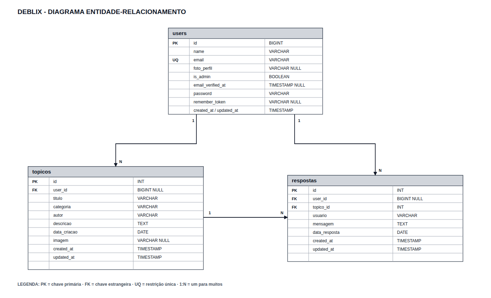
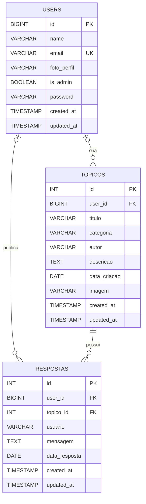

# DER da Base de Dados do Deblix

Arquivos do diagrama: [`PNG`](docs/der-deblix.png) e [`SVG`](docs/der-deblix.svg).

## Entidades

## Relacionamentos

| Origem | Destino | Cardinalidade | Exclusão |
| --- | --- | --- | --- |
| `users.id` | `topicos.user_id` | Um usuário cria vários tópicos | O tópico permanece com `user_id` nulo |
| `users.id` | `respostas.user_id` | Um usuário publica várias respostas | A resposta permanece com `user_id` nulo |
| `topicos.id` | `respostas.topico_id` | Um tópico possui várias respostas | As respostas são excluídas em cascata |

## Regras

- `users.email` é único.
- `topicos.user_id` e `respostas.user_id` aceitam valor nulo.
- `topicos.imagem` e `users.foto_perfil` armazenam apenas o caminho do arquivo.
