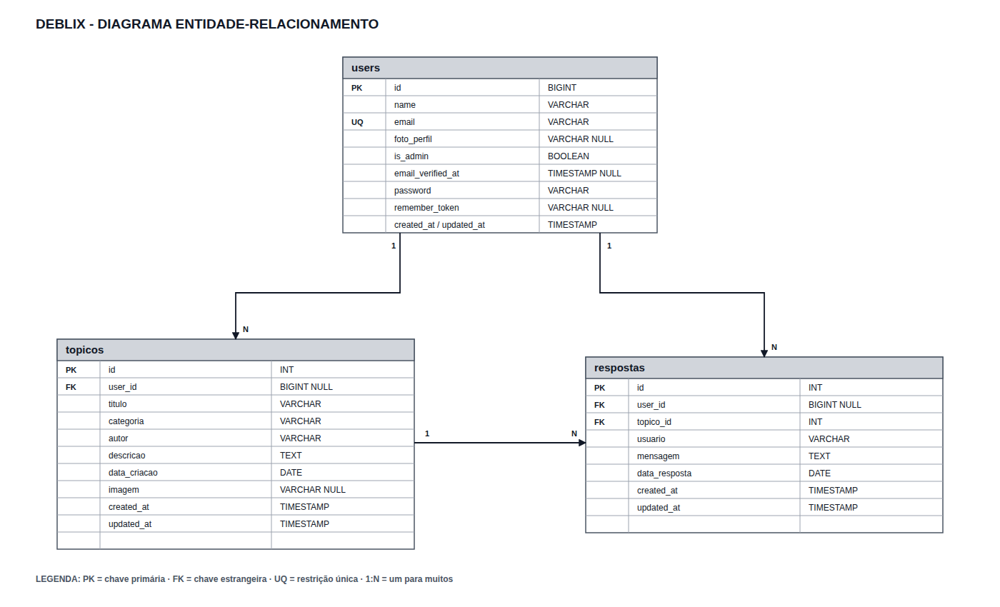

# Deblix

Deblix é um fórum desenvolvido em Laravel para publicação de tópicos e respostas.

## Stack

- Laravel 10
- PHP 8.1+
- Blade
- Bootstrap 5 via CDN
- CSS próprio
- MySQL
- GitHub Actions, Apache e EC2

## Funcionalidades

- Cadastro, login, logout e edição de perfil.
- Foto de perfil.
- CRUD de tópicos com categoria e imagem.
- Busca, filtro por categoria e ordenação de tópicos.
- Criação, edição e exclusão de respostas.
- Permissões para o dono do conteúdo e para o superusuário.
- Superusuário padrão: `admin@admin.com`, usuário `admin` e senha `admin`.

## Base de dados

O banco utiliza as tabelas `users`, `topicos` e `respostas`.

Os relacionamentos e campos estão detalhados em [`DER_BANCO_DE_DADOS.md`](DER_BANCO_DE_DADOS.md).
